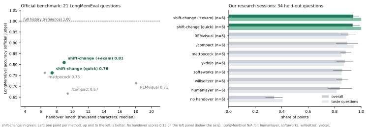

# shift-change 换班

**让下一个会话，像这一个一样懂你。**

给编程 agent 用的交接技能：把工作的"灵魂"带过去——你的品味、被否决的路线、还在跑的任务、哪些只是假设。关会话之前，先让一个全新的 agent 考一遍，**证明**它真的接住了。

[English](README.md) | 中文

<!-- demo: docs/assets/demo.gif -->

---

## 问题

你和 agent 一起干了三个小时。它学会了你要"先给结论"，知道降学习率已经试过、没用，知道"clean set"具体指哪个文件，也知道集群上还跑着一个 sweep。然后上下文满了，或者你 `/clear` 了，或者第二天回来接着做。

新会话读了总结，知道**做了什么**，却不知道**你希望怎么做**。于是它又提议那个被否决的方案，又给你写一大段，还把正在跑的任务重新提交了一遍。就像老员工走了，来了个完全不了解情况的新人。

## 思路：向医院学

医院每天要换好几次班，交接一直是医疗差错的重要来源。**I-PASS** 交接协议用结构化交接解决了这个问题，多中心研究显示医疗差错下降了 23%（Starmer et al., *NEJM* 2014）。它最关键的是最后一步：**接班的人要把交接内容复述一遍**，趁交班的人还在，把漏洞当场补上。

`shift-change` 把交班和接班两头都替编程 agent 做了：

1. **写**一份 I-PASS 交接文档，内容包括：
   - 状态、全局图景和当前假设
   - 下一步行动
   - 禁区：带否决原因，以及什么条件下可以重开
   - 你的纠正，整理成规则表
   - 证据账本：哪些已验证、哪些是假设、哪些还未知
2. **挖掘原始对话记录**，而不是只靠 agent 自己的记忆。自动压缩会丢掉早期的对话，而你恰恰是在早期纠正 agent 最多的。
3. **考试**：只把交接文档交给一个全新的子 agent，然后考它，比如"用户要 X，你做 A 还是 B？""师兄建议降学习率，你怎么回？"。答错一题就在文档里补上这一处，再换一个新 agent 重考，直到通过。

最后你拿到的是一行 `Handover fidelity: 12/12 (after 1 patch round)`，不用再凭感觉赌它接没接住。

## 包含什么

| Skill | 什么时候用 | 做什么 |
|---|---|---|
| `/shift-change` | 会话结束时 | 写一份带名字的交接文档，跑考试，提议把长期品味写进 `CLAUDE.md` |
| `/shift-start` | 新会话开始时 | 你确认会话名字后，核对交接内容和实际情况，复述计划和最不确定的地方，**等你确认再动手**，然后删掉这份交接 |
| `/shift-recover` | 上个会话没来得及交接就断了 | 列出最近的会话让你确认是哪一个，挖出当时的对话记录，核对实际完成了什么（git、作业、半截输出），复述一份续做计划 |
| `/shift-brief` | 把任务交给合作者时 | 找齐任务需要的每个文件，清理密钥和本机路径，写好可以直接运行的验收命令，以及给**对方 agent** 用的开场提示词，发送前再让全新 agent 只凭这个包冷启动一遍 |

## 基准测试

**测试设置：**
- 两段模拟的研究会话，都以真实的 Claude Code 会话回放：
  - ML 调试，中途压缩 1 次；
  - 论文返修，中途压缩 3 次。
- 34 道留出题，全部在开跑前写好。
- 10 种交接方法，每个会话各跑 3 次，共 60 次运行。

每次交接之后，由一个从没见过原会话的全新 agent，只凭交接文档和代码仓库答题。另有一套测试在 **LongMemEval**（Wu et al., ICLR 2025）上做同样的对比，题目、标准答案和评分提示词全部用官方的，这样结论就不只依赖我们自己写的会话。



| 方法 | 总分（均值 ± 标准差） | 品味 | 压缩前的信息 | 否决的路线 | 被推翻的决定 | 交接耗时（中位数） |
|---|---|---|---|---|---|---|
| **shift-change**（带考试） | **0.94 ± 0.05** | **1.00** | **0.99** | **1.00** | **0.94** | 184 秒 |
| **shift-change 快速版** | **0.94 ± 0.06** | **1.00** | 0.97 | 0.94 | 0.83 | 133 秒 |
| REMvisual `handoff` | 0.90 ± 0.06 | 0.89 | 0.94 | 0.94 | 0.83 | 206 秒 |
| Claude Code `/compact` | 0.89 ± 0.08 | 0.94 | 0.95 | 0.89 | 0.83 | 101 秒 |
| mattpocock `handoff` | 0.88 ± 0.04 | 0.85 | 0.90 | 0.89 | 0.89 | 87 秒 |
| ykdojo `handoff` | 0.88 ± 0.06 | 0.87 | 0.89 | 0.83 | 0.83 | 65 秒 |
| softaworks `session-handoff` | 0.86 ± 0.07 | 0.85 | 0.90 | 0.78 | 0.83 | 288 秒 |
| willseltzer `create` | 0.86 ± 0.04 | 0.85 | 0.92 | 0.83 | 0.83 | 106 秒 |
| humanlayer `create_handoff` | 0.84 ± 0.09 | 0.81 | 0.89 | 0.83 | 0.89 | 96 秒 |
| 不交接 | 0.34 ± 0.07 | 0.41 | 0.40 | 0.22 | 0.50 | – |

这张合成会话的表，是 2026-09-18 当时的 skill 版本跑出来的，那时还没有"必读文件""关于用户""时间换算成绝对日期"这几条改动。我们保留原始测量结果，不拿新版本重跑再悄悄换上去；下面 LongMemEval 那张表用的是冻结版本，版本号记录在每个结果文件里。

**这组数据能说明什么、不能说明什么：**
- **任何交接都远胜于不交接。** 流行的交接 skill 集中在 0.84–0.90，`/compact` 本身就是很强的基线。
- **shift-change 在两个会话里都是最高分。** 差距最明显的是品味（每一次都是 1.00）和否决的路线。但它对最强竞品的总分领先幅度不大，在一个标准差以内。
- **考试并不会让分数高于快速版。** 它的价值在于你关掉会话**之前**就能看到一个保真度分数，代价是多花约 50 秒。
- **有一类题目谁都没分出高下：**"这是谁的假设"。原因见 [CHANGELOG](CHANGELOG.md)。

### LongMemEval（官方题目、官方评分提示词）

[LongMemEval](https://github.com/xiaowu0162/longmemeval)（Wu et al., ICLR 2025）的 21 道留出题，每种方法对每道题各交接一次，用该基准自带的分题型评分提示词打分。skill 是在**另一批完全不重复**的开发题上改好并冻结之后，才跑的这一轮。

| 方法 | 答对 | 交接长度（中位数） |
|---|---|---|
| 完整历史（上限参照，什么都能看） | **21 / 21** | – |
| **shift-change**（带考试） | **17 / 21** | 9.0k 字符 |
| **shift-change 快速版** | 16 / 21 | 7.4k 字符 |
| mattpocock `handoff` | 16 / 21 | 6.5k 字符 |
| REMvisual `handoff` | 15 / 21 | 18.1k 字符 |
| Claude Code `/compact` | 14 / 21 | 9.4k 字符 |
| 不交接 | 4 / 21 | – |

该怎么读这组数：

- **对最强竞品只领先 1 题。** 逐题配对看：对 mattpocock 是赢 2 题、输 1 题、平 18 题。**这不是显著差异**；写成"0.81 对 0.76"会让 1 道题看起来像一道鸿沟。
- **对 `/compact` 的差距才算明显**（赢 4 输 1 平 16），和我们自己的会话测试结论一致。
- **读完整历史能拿满分 21/21，碾压所有交接方法。** 交接本质是压缩；要翻出长会话里某个边角细节，什么都比不过把原文摆在面前。交接的意义在于**那份原文你已经没有了**。
- **长不等于好。** REMvisual 用了两倍篇幅，却少答对 2 题。
- **考试这次赚回了成本**（比快速版多对 1 题），代价是耗时翻倍；但在我们自己的会话测试里它没带来提升。所以它的价值是**给你一个能看的检查结果**，不是分数放大器。

测试方法、会话、题目、原始输出，以及因基础设施故障被剔除的运行，都在 [`bench/`](bench/)。逐项功能对比见 [`docs/comparison.md`](docs/comparison.md)，触发与输出用例见 [`evals/`](evals/)，对照 Anthropic 官方 skill 编写规范的审查见 [`docs/standards.md`](docs/standards.md)。

## 安装

**Claude Code 插件**
```
/plugin marketplace add https://github.com/ruijiezh67/shift-change
```
然后
```
/plugin install shift-change@shift-change
```

**任何支持 Agent Skills 的 agent**
```bash
npx skills add ruijiezh67/shift-change
```

**手动安装**
```bash
git clone https://github.com/ruijiezh67/shift-change
cp -r shift-change/skills/* ~/.claude/skills/
```

**或者直接跟你的 agent 说：**"帮我安装 https://github.com/ruijiezh67/shift-change 里的 skills"

## 用法

```
/shift-change                 # 完整交接 + 考试（多花几分钟）
/shift-change quick           # 只交接，不考试
/shift-change 下次把消融表做完    # 告诉它下个会话的目标
```
新会话里：
```
/shift-start                  # 列出待接手的会话，你确认名字后它就复述
/shift-start clip-sweep       # 或者直接报名字
```
每份交接存成 `.shift/<会话名>-<日期>-<时间>.md`，所以接班时你只要确认一个名字，不用记路径。你确认复述之后，`/shift-start` 会删掉刚接手的那份，`.shift/` 里始终只留还没接手的会话。
上个会话没交接就断了（额度用完、崩溃、误点 `/clear`）：
```
/shift-recover
```

把活交给别人：
```
/shift-brief tokenizer 消融实验，交给有集群权限的师弟
```

交接文档存在 `.shift/`，会自动加进 `.gitignore`（里面可能有私人备注），接手之后自动删除。

## 常见问题

**为什么不直接 `/compact`？** 在我们的测试里，压缩是很强的基线（0.89），只要你还在同一个会话里，就放心用它。`shift-change` 管的是会话结束之后：
- 写出一份新会话或者另一台机器都能接手的文件；
- 把你的纠正写成明确的规则；
- 用一个分数告诉你，全新的读者是否真的接住了。

**和其他交接 skill 有什么区别？** 大多数交接 skill 只是凭 agent 的记忆写一份状态总结。`shift-change` 会读原始对话记录，把你的纠正写成规则，给每个结论标上"已验证"还是"只是假设"，并且用全新 agent 实测交接效果。

**只支持 Claude Code 吗？** 这几个 skill 遵循开放的 Agent Skills 格式。挖掘对话记录和子 agent 考试需要 Claude Code。在其他 agent 上，交接改用 agent 自己的上下文，并做一次自检，同时会明确告诉你没有经过独立考试。

## 理念

- 交接文档是写给陌生人的，不是写给自己的。
- 品味是可以检查的行为，不是形容词。
- 没有证据的结论只是假设，要标出来。
- 没经过检验的交接，只能算一个愿望。

## 许可证

MIT
